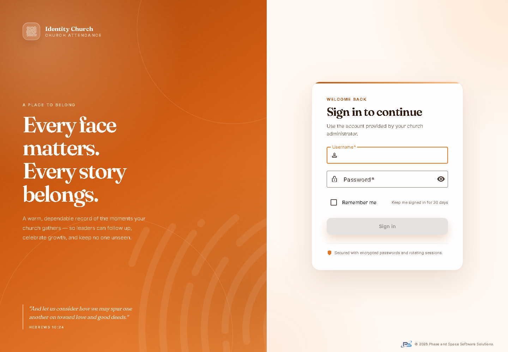
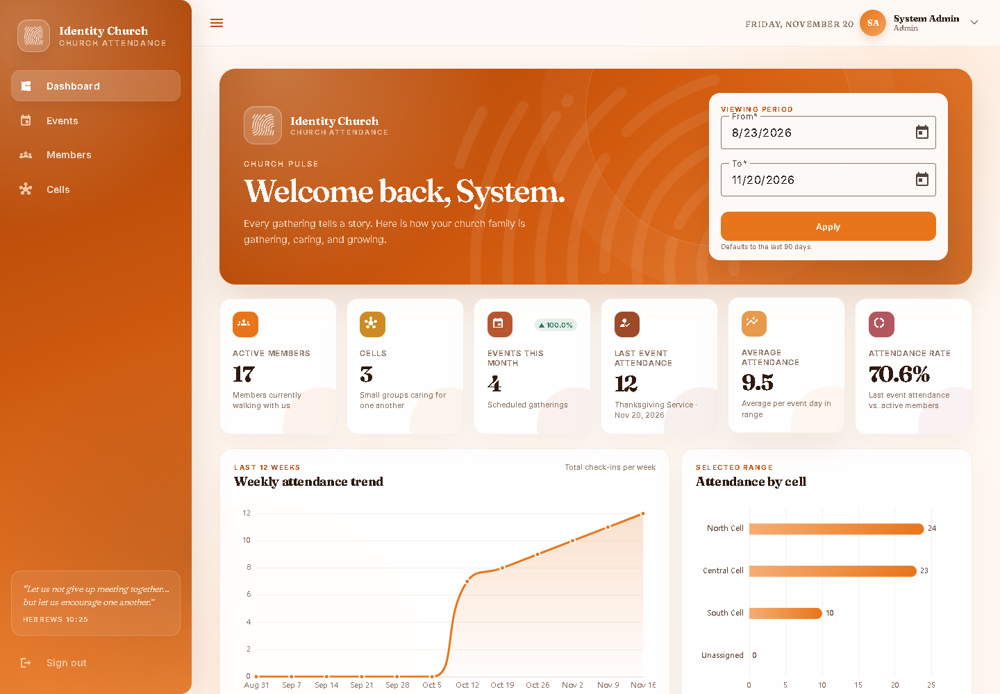
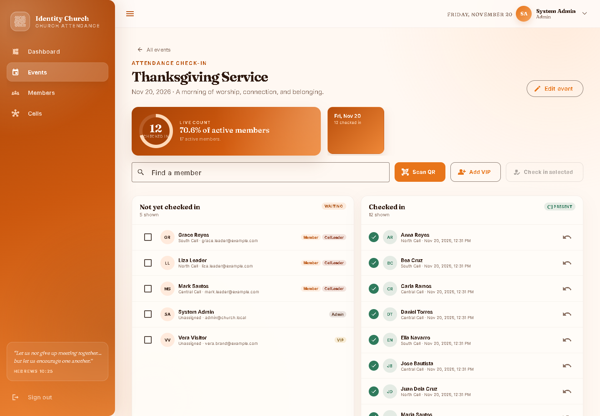
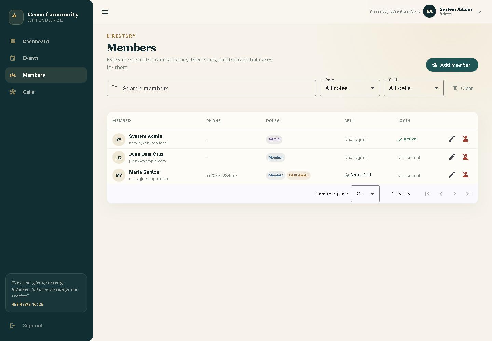
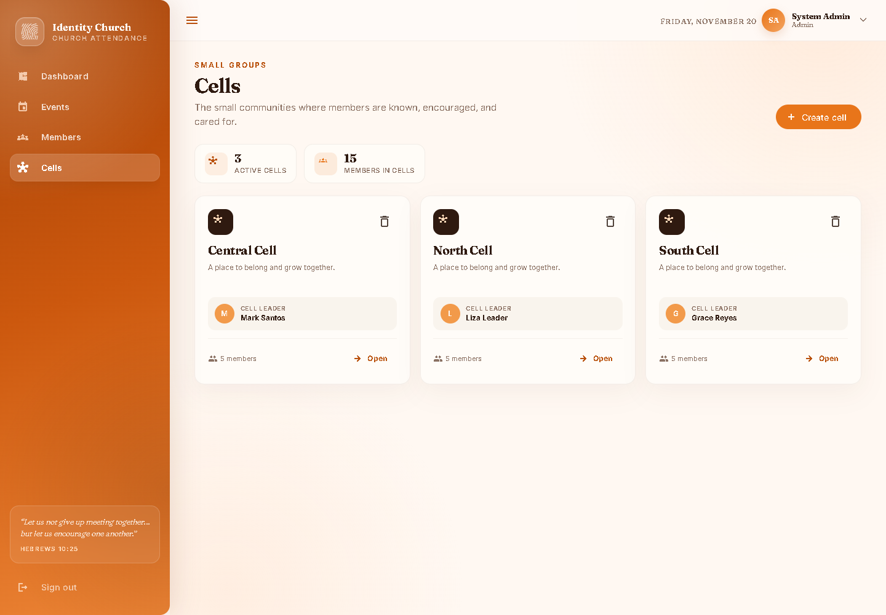
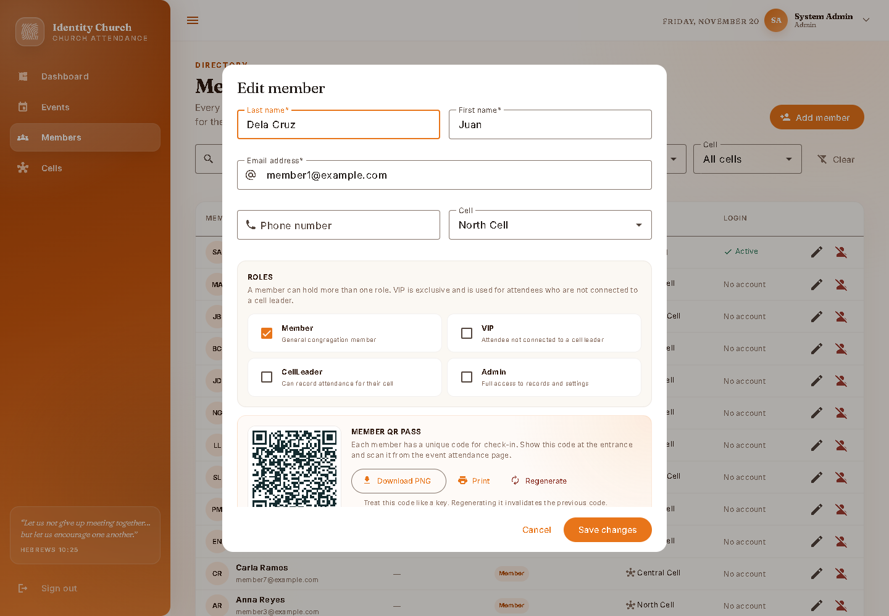
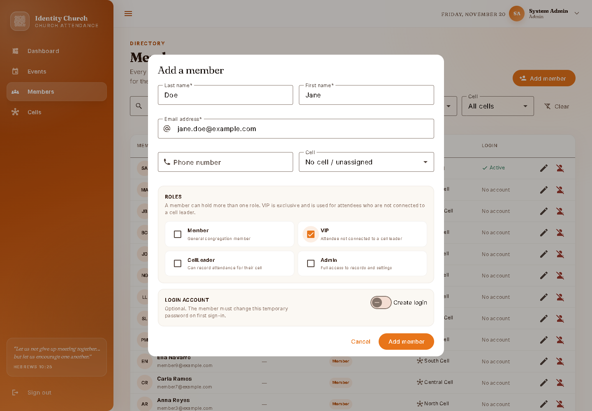
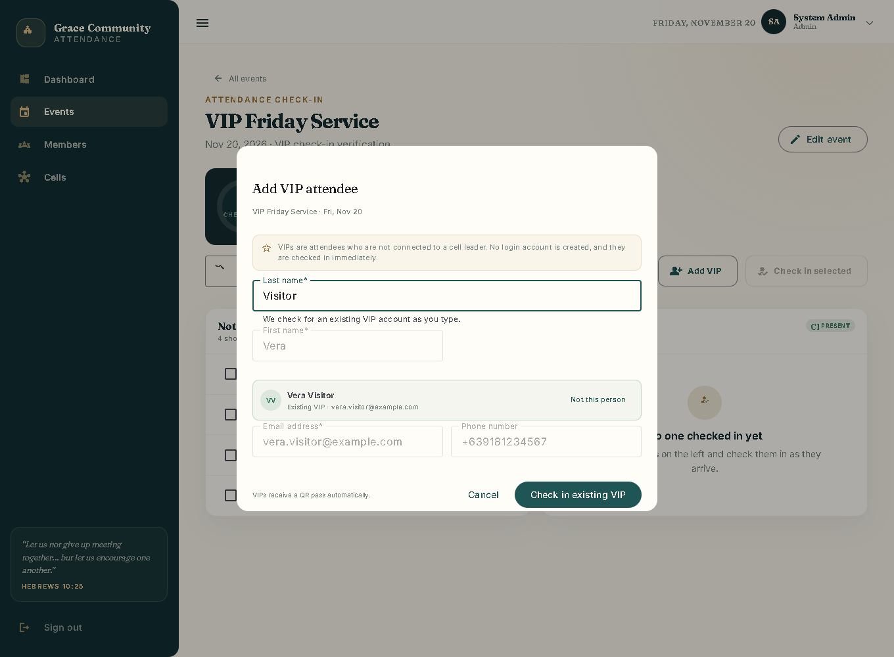

# Identity Church Attendance

A full-stack attendance platform for **Identity Church**: member directory, cells (small groups), single- and multi-day events, day-by-day attendance check-in, and a leadership dashboard.

Built from the supplied technical specification with **ASP.NET Core 8**, **PostgreSQL**, **Entity Framework Core**, and **Angular 20** (standalone components + signals).



## Features

- **JWT authentication** with 15-minute access tokens, rotating hashed refresh tokens, "Remember me" (30 days), account lockout after five failed attempts, and forced first-login password change.
- **Members** with multiple roles (`Member`, `VIP`, `CellLeader`, `Admin`), optional cell assignment, soft deletion, filtered/paged directory, and optional login-account creation. Creating login accounts is restricted to Admins.
- **Cells** with exactly one validated `CellLeader`, no member cap, leader/member detail views, add/remove members, and soft deletion.
- **Events** with a single-day/multi-day toggle, server-generated `event_days`, and protected date edits when attendance already exists.
- **Attendance check-in** for Admins and Cell Leaders, with idempotent check-ins, per-day tabs, search, live counts, and undo.
- **QR check-in**: every member has a unique QR pass, available from **Members → Edit member**, with download/print and rotation. Attendance pages include a camera QR scanner plus image-upload fallback.
- **VIP check-in**: from **Events → Attendance**, Admins can add a walk-in VIP with an optional inviter. Last-name lookup reuses an existing VIP account; otherwise a VIP with no cell or login is created and checked in immediately.
- **Dashboard** with KPI cards, zero-filled weekly trend, attendance by cell, six-month comparison, recent-event widget, date-range filter, and ECharts visualizations.
- **Security**: BCrypt work factor 11, role-based authorization, ProblemDetails errors, lockout, token rotation/reuse revocation, CORS allow-list, and forced password change.
- **Responsive UI** built with Angular Material, designed for mobile check-in.

## Stack

| Layer | Technology |
|---|---|
| Database | PostgreSQL 15+ (tested on 16) |
| API | ASP.NET Core 8, EF Core 8, Npgsql |
| Frontend | Angular 20, Angular Material, signals, ngx-echarts, `qrcode`, `html5-qrcode` |
| Auth | JWT access token + rotating refresh token |
| Tests | xUnit, WebApplicationFactory, Jasmine/Karma |

## Repository layout

```text
.
├── src/
│   ├── ChurchAttendance.Domain/          Entities and role constants
│   ├── ChurchAttendance.Application/     DTOs, services, validators, rules
│   ├── ChurchAttendance.Infrastructure/  DbContext, EF configs, migrations, security
│   └── ChurchAttendance.Api/             Controllers, middleware, Program.cs
├── tests/ChurchAttendance.Tests/          Unit + end-to-end API tests
├── frontend/                             Angular standalone application
├── Dockerfile.api
├── docker-compose.yml
└── docs/screenshots/
```

## Quick start with Docker

1. Copy the environment template and set a real JWT secret:

   ```bash
   cp .env.example .env
   # edit .env: JWT_KEY must be at least 32 characters
   ```

2. Start the stack:

   ```bash
   docker compose up --build
   ```

3. Open:

   - Web app: <http://localhost:8088>
   - Swagger: <http://localhost:8080/swagger>
   - Health: <http://localhost:8080/health>

4. Sign in with the seeded administrator:

   ```text
   username: admin
   password: ChangeMe#123!
   ```

   The first sign-in redirects to **Change password**. The account cannot use the rest of the API until the temporary password is changed.

## Local development

### Prerequisites

- .NET 8 SDK (recommended for running the test suite)
- Node.js 20.19+ or 22.12+
- PostgreSQL 15+ (or Docker for just the database)

> The API targets `net8.0` and is configured with `<RollForward>Major</RollForward>`. If .NET 8 is not installed on the machine, it can run on a newer installed .NET runtime. For exact target parity—and for `dotnet test`—install the .NET 8 SDK.

### 1. Database

The development connection string in `src/ChurchAttendance.Api/appsettings.json` expects PostgreSQL on **localhost:5433**:

```text
Host=localhost;Port=5433;Database=church_attendance;Username=postgres;Password=postgres
```

Start one with Docker:

```bash
docker run --name church-postgres -e POSTGRES_PASSWORD=postgres \
  -e POSTGRES_DB=church_attendance -p 5433:5432 -d postgres:16-alpine
```

Or point `ConnectionStrings__DefaultConnection` at an existing database.

### 2. API

```bash
dotnet restore ChurchAttendance.sln
dotnet run --project src/ChurchAttendance.Api
```

The API starts at <http://localhost:5180>, applies EF Core migrations automatically, seeds the four roles, and creates the default admin on an empty database.

Swagger: <http://localhost:5180/swagger>

### 3. Angular

```bash
cd frontend
npm install
npm start
```

The dev server runs at <http://localhost:4200> and proxies `/api` to `http://localhost:5180` through `frontend/proxy.conf.json`.

## Troubleshooting

### “To install missing framework … Microsoft.NETCore.App 8.0.0”

This means the machine has no .NET 8 runtime. The API uses `<RollForward>Major</RollForward>`, so after rebuilding it can run on the installed newer .NET runtime:

```bash
dotnet build src/ChurchAttendance.Api
dotnet run --project src/ChurchAttendance.Api
```

If you are launching an old build directly from `bin`, or using `--no-build`, remove the old build output and rebuild first:

```powershell
Get-Process ChurchAttendance.Api -ErrorAction SilentlyContinue | Stop-Process -Force
Remove-Item src/ChurchAttendance.Api/bin, src/ChurchAttendance.Api/obj -Recurse -Force
dotnet run --project src/ChurchAttendance.Api
```

To install the exact target framework, install the **.NET 8 SDK** from <https://dotnet.microsoft.com/download/dotnet/8.0> or run:

```powershell
winget install Microsoft.DotNet.SDK.8
```

Then close and reopen the terminal and verify:

```powershell
dotnet --list-runtimes
# should include Microsoft.AspNetCore.App 8.0.x and Microsoft.NETCore.App 8.0.x
```

If the API now starts but cannot connect, make sure PostgreSQL is running on **localhost:5433** as described above. If it still fails, send the exact command and the full error text.

## Configuration

Secrets and deployment settings are read from `appsettings*.json` and environment variables. Never commit production secrets.

| Setting | Purpose | Default |
|---|---|---|
| `ConnectionStrings__DefaultConnection` | PostgreSQL connection | localhost:5433, `church_attendance` |
| `Jwt__Key` | HMAC signing key, **32+ bytes** | development-only placeholder |
| `Jwt__Issuer` / `Jwt__Audience` | Token validation | `ChurchAttendance` / `ChurchAttendance.Web` |
| `Jwt__AccessTokenMinutes` | Access token lifetime | `15` |
| `Jwt__RefreshTokenHours` | Refresh lifetime without Remember me | `12` |
| `Jwt__RememberMeDays` | Refresh lifetime with Remember me | `30` |
| `Seed__AdminUsername` / `Seed__AdminPassword` | First administrator | `admin` / `ChangeMe#123!` |
| `Church__TimeZoneId` | Church-local date boundary | `Asia/Manila` |
| `Cors__AllowedOrigins__0` | Allowed Angular origin | `http://localhost:4200` |
| `Https__Redirect` | Redirect HTTP to HTTPS | `false` in dev, `true` in production |
| `Database__Provider` | `Postgres` or `InMemory` (tests) | `Postgres` |

For Docker Compose, place `JWT_KEY`, `POSTGRES_PASSWORD`, and optionally `SEED_ADMIN_PASSWORD` in `.env`.

### HTTPS

TLS is expected to terminate at a reverse proxy for the Docker demo (nginx serves HTTP internally). Set `Https__Redirect=false` behind an HTTP-only proxy, or configure TLS and forwarded headers and enable redirect. Never deploy the development JWT key.

## Database

- EF Core code-first migrations live in `src/ChurchAttendance.Infrastructure/Persistence/Migrations`.
- The API applies pending migrations at startup with retry, then seeds roles and the default admin.
- Tables use `snake_case`, UUID primary keys, `TIMESTAMPTZ` timestamps, and partial/unique indexes that enforce:
  - one active cell per leader,
  - one cell per member,
  - one attendance row per member per event day,
  - unique member email, username, and cell name.

Relevant entities: `users`, `refresh_tokens`, `members` (including `qr_token` and `invited_by_member_id`), `member_roles`, `roles`, `cells`, `events`, `event_days`, `attendance`.

## API summary

All routes are under `/api`. Errors use RFC 7807 `ProblemDetails`. Lists default to 20 items and cap at 100.

| Area | Endpoints |
|---|---|
| Auth | `POST /auth/login`, `POST /auth/refresh`, `POST /auth/logout`, `POST /auth/change-password`, `GET /auth/me` |
| Members | `GET /members`, `GET /members/{id}`, `POST /members`, `PUT /members/{id}`, `DELETE /members/{id}`, `GET /members/{id}/qr-code`, `POST /members/{id}/qr-code/rotate`, `GET /members/vip-lookup?lastName=`, `GET /members/inviter-options?search=` |
| Cells | `GET /cells`, `GET /cells/{id}`, `POST /cells`, `PUT /cells/{id}`, `DELETE /cells/{id}`, `POST /cells/{id}/members`, `DELETE /cells/{id}/members/{memberId}` |
| Events | `GET /events`, `GET /events/{id}`, `POST /events`, `PUT /events/{id}`, `DELETE /events/{id}?force=true` |
| Attendance | `GET/POST /events/{eventId}/days/{dayId}/attendance`, `POST .../attendance/scan`, `POST .../attendance/vip`, `DELETE .../attendance/{memberId}` |
| Dashboard | `/dashboard/kpis`, `/dashboard/weekly-trend`, `/dashboard/attendance-by-cell`, `/dashboard/monthly-comparison`, `/dashboard/recent-events` |

Use Swagger for request/response schemas.

## QR check-in

1. Sign in as an Admin and open **Members**.
2. Click **Edit** on a member. The **Member QR pass** panel loads a unique QR code with **Download PNG**, **Print**, and **Regenerate** actions.
3. Open **Events → Attendance** for the correct event day and click **Scan QR**.
4. Scan the pass with the device camera, or choose **Upload QR image** if the camera is unavailable.
5. The member is checked in immediately; scanning the same pass again is idempotent and reports “Already checked in”.

Implementation details:

- The QR payload is `church-attendance://member/<64-hex-token>`.
- Tokens are random 32-byte values, stored in `members.qr_token` with a unique index and never exposed in normal member list/detail responses.
- A Cell Leader may only scan members in the cell they lead; Admins may scan any active member.
- Regenerating a QR immediately invalidates the previous code.
- Camera access requires **HTTPS** (or `localhost`). Image upload is available as a fallback on HTTP/LAN deployments.

## VIP check-in

1. Sign in as an Admin and open **Events → Attendance** for the correct event day.
2. Click **Add VIP**.
3. Start typing the attendee’s last name. The app searches active VIP accounts:
   - One match is selected automatically.
   - Multiple matches are shown so the correct person can be chosen.
   - If no match exists, complete the first name, email, and optional phone number.
4. Optionally choose the member who invited them. Leave **Invited by** blank for a walk-in.
5. Click **Add & check in** (or **Check in existing VIP**).
6. The VIP is immediately marked present for that event day.

Implementation details:

- A newly created quick VIP has the `VIP` role, no cell, and **no login account**.
- Existing VIPs are checked in through their existing member ID; duplicate check-in is idempotent.
- The server also reuses an existing VIP when the exact first and last name already exist.
- `invited_by_member_id` stores the optional inviter; VIPs are excluded from the inviter picker.
- The quick-add endpoints are Admin-only because VIPs are outside Cell Leader scope.
- Every VIP receives a QR pass automatically and can later download it from **Members → Edit**.

## Business-rule defaults chosen

The specification left several decisions open. This implementation uses:

- **Cell leader validation:** assigning a leader without the `CellLeader` role is rejected with `400`; the role is **not** auto-granted.
- **VIP role:** VIP is mutually exclusive with Member, CellLeader, and Admin, and a VIP cannot be assigned to a cell. In the member form, choosing VIP clears other roles and the cell; choosing a cell switches the member to Member. VIP members cannot be added to a cell until their role is changed.
- **VIP quick check-in:** Admins can add a VIP from the attendance page. The optional inviter is stored on the member; last-name lookup reuses an existing VIP, otherwise a new VIP is created with no cell or login and checked in immediately.
- **Login creation:** only Admins can create member login accounts. The API enforces this independently of the UI.
- **Cell membership:** one cell per member. Adding a member who already belongs to another cell is rejected.
- **Leader membership:** when a leader has no cell, creating/updating a cell adds them to it as a member. A leader may also be a member elsewhere.
- **Attendance:** manual check-in or QR scan by Admins and Cell Leaders. A Cell Leader can only see/check in members of the cell they lead.
- **Member QR passes:** one stable opaque token per member; only Admins can view or rotate a member’s QR code.
- **Dashboard scope:** Admins see all data; Cell Leaders see aggregate data scoped to their own cell. Events-this-month counts remain church-wide.
- **Dashboard item (e):** implemented as a **Recent events** widget.
- **Extra member fields:** none were added beyond the specified name, email, phone, roles, and cell.
- **Deletion:** members and cells are soft-deleted (`is_active=false`); attendance history is preserved. Event deletion asks for confirmation (`force=true`) when attendance exists.
- **Dates:** event dates are plain `DATE`s; the church-local "today" uses `Church:TimeZoneId` (`Asia/Manila`).

## Security notes

- Passwords are hashed with BCrypt at work factor 11.
- Refresh tokens are random 64-byte values, stored only as SHA-256 hashes and rotated on every refresh. Reuse of a revoked token revokes all active sessions for that user.
- Five failed logins lock the account for 15 minutes.
- Access tokens are short-lived and carry role claims; authorization is enforced server-side, not only in the UI.
- Member QR tokens are bearer credentials for attendance. They are shown only to Admins and can be rotated from the member edit dialog; treat printed copies like keys.
- Refresh tokens are kept in `localStorage` when "Remember me" is checked and `sessionStorage` otherwise, as specified. For a higher-security deployment, move refresh tokens to `HttpOnly; Secure; SameSite=Strict` cookies and add CSRF protection.
- Force `Https__Redirect=true` or terminate TLS at a trusted proxy in production.
- Replace `Jwt__Key` and the seed password before deployment.

## Tests

### Backend

```bash
dotnet test ChurchAttendance.sln
```

Covered: forced password change, login, member creation, Admin-only login creation, VIP exclusivity and cell restrictions, VIP last-name lookup/inviter/check-in, QR generation/scan/rotation, event/day generation, attendance check-in, dashboard KPIs/monthly endpoint, event date protection, cell leader validation, login lockout, refresh rotation/reuse, and BCrypt verification.

### Frontend

```bash
cd frontend
npm test -- --watch=false --browsers=ChromeHeadless
```

Covered: token storage for Remember me, refresh rotation, login form validation, QR service endpoints, and dashboard navigation.

## Screenshots

| Dashboard | Attendance |
|---|---|
|  |  |

| Members | Cells |
|---|---|
|  |  |

| Member QR pass | VIP role form |
|---|---|
|  |  |

| VIP check-in |
|---|
|  |

## Notes on the reference specification

The implementation keeps the intended Clean-ish layering while staying pragmatic:

- The domain project has no infrastructure dependencies.
- `Application` owns services, DTOs, validators, and the persistence abstraction.
- `Infrastructure` owns EF Core, migrations, JWT/BCrypt implementations, and seeding.
- `Api` owns controllers, auth middleware, ProblemDetails handling, Swagger, and startup.
- Frontend feature folders follow `core / shared / features`, with lazy-loaded standalone routes and functional guards/interceptors.

---

© 2026 Phase and Space Software Solutions.

